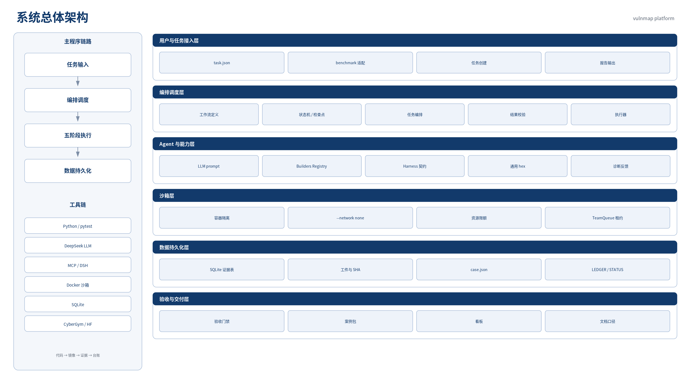
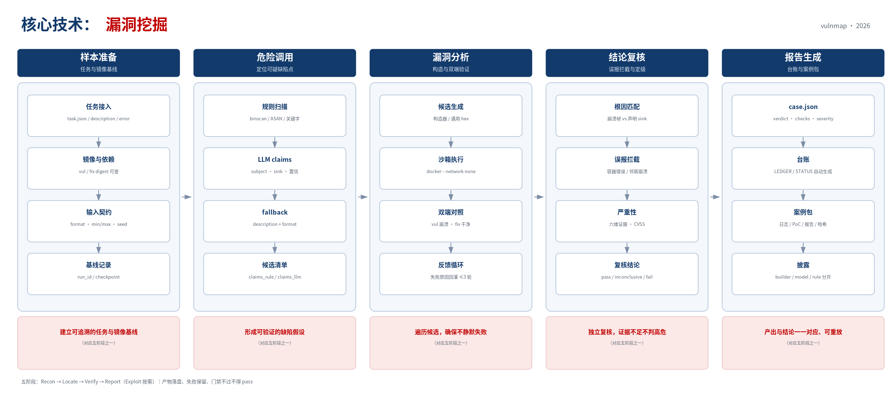
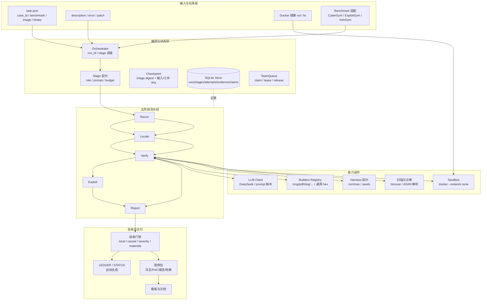

# 平台架构 / 技术路线

源文件：`assets/architecture.svg`（可编辑），Mermaid 源如下。

## 各层职责

| 层 | 职责 | 关键约束 |
|---|---|---|
| 输入层 | 任务描述、崩溃信息、镜像、benchmark 适配 | 镜像 digest 必须可查，否则 checkpoint 拒绝 |
| 编排层 | 阶段调度、预算、租约、检查点、SQLite 证据 | run_id 贯穿；checkpoint 绑定 digest+sha |
| 五阶段 | recon→locate→verify→exploit→report | 每阶段产物落盘，失败保留 |
| 能力组件 | 模型、构造器、harness 契约、沙箱、扫描 | 构造器可被 `allow_builders=false` 禁用 |
| 验收交付 | 门禁、台账、案例包、看板 | 门禁不过不得 pass |

## 技术路线（当前定位）

1. 先保证“可复现”：镜像、输入、日志、哈希可追溯；
2. 再保证“可判定”：vul 崩 / fix 干净 / 根因匹配；
3. 最后区分贡献：builder / model / rule，不混算；
4. 自主性用冻结盲测单独验证，当前 0/4。
## 工具边界（2026-11-15）

- 当前 benchmark 是**源码 + 容器内预编译二进制**，不是固件；
- 定位用源码检索 + ASAN 帧 + binutils（nm/readelf/addr2line），不依赖 IDA/Ghidra；
- IDA/Ghidra 仅在未来接入无源码/固件任务时考虑，现阶段不列入“已实现”；
- 方案修订版中的 IDA-MCP 已改为“源码优先，无源码场景可选”。
