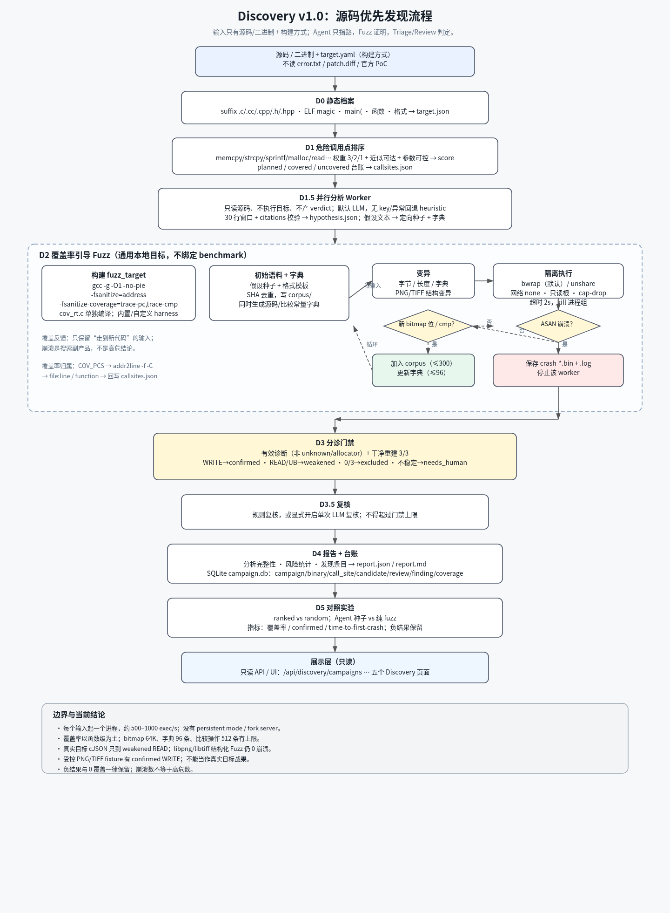
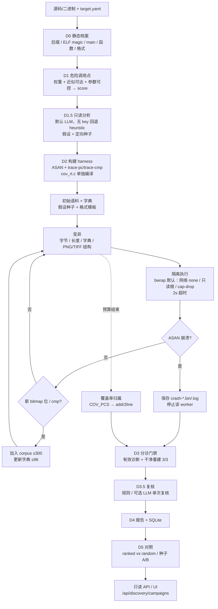

# Discovery v1.0 流程图



- 源文件：`assets/flowchart.svg`
- 生成脚本：`scripts/gen_discovery_flowchart.py`（改流程时改脚本并重渲染，不手改 SVG）
- 工具标注版：`assets/flow-tools.png`（`assets/flow-tools.svg`）
- 旧五阶段复现流程图已归档；本图只描述 Discovery v1.0。

## Mermaid 源



## 关键口径

- **输入**：只有源码/二进制与构建方式；不读 `error.txt`、`patch.diff`、官方 PoC；
- **Fuzz 循环**：变异 → 隔离执行 → ASAN 判定 → 新覆盖/新比较常量入库 → 再变异；崩溃是搜索副产品；
- **门禁**：有效诊断（非 `unknown/allocator/OOM`）+ 独立目录干净重建 3/3；干净构建失败或复用旧构建只能 `needs_human`；
- **结论**：写 + 3/3 = `confirmed`；读/UB + 3/3 = `weakened`；0/3 = `excluded`；不稳定 = `needs_human`；
- **负结果**：0 崩溃、覆盖率不足、构建失败都保留，不删除、不改写；
- **边界**：每个输入一个进程（约 500–1000 exec/s），没有 persistent mode；覆盖率以函数级为主；真实目标 WRITE/UAF 尚未命中；受控 fixture 的 confirmed 不能当作真实目标战果；
- **与旧流程的区别**：旧流程读 task.json/error/patch，跑 vul/fix 双端；Discovery 不依赖已知崩溃位置，vul/fix 差分/flag 不属于本图。

## 复现

```bash
cd vulnmap
python3 scripts/gen_discovery_flowchart.py
microsoft-edge --headless=new --disable-gpu --no-sandbox \
  --user-data-dir=/tmp/edge-flow --window-size=1440,1960 \
  --screenshot="$PWD/docs/assets/flowchart.png" "file://$PWD/docs/assets/flowchart.svg"
```
