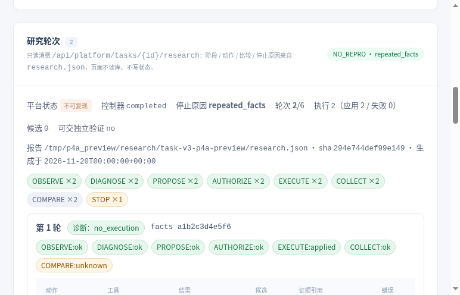
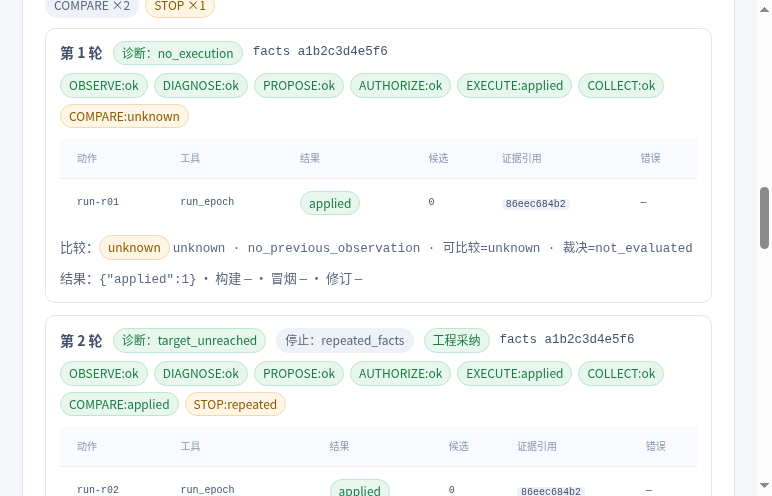

# V3 P4a：研究轮次的只读 CLI / API / 页面时间线（V3-014）

对应《VULNMAP-V3 完整升级方案》§4「双循环与状态模型」、§9「统一数据契约」、
§12「独立验证」与 §18.1 门禁，前置 P3。P2a–P2c 把研究循环接上了真入口
（`bin/platform.py run <task> --research` → `research.json` + 事件），
**P4a 只做一件事：把这条循环已经写下来的轮次事实，用只读的 CLI / API /
页面暴露出来**，并且不给运行期能力加一根杠杆。

---

## 0. 实施清单

| 项 | 状态 | 验收口径 | 落点 |
|---|---|---|---|
| P4a-1 `research-status` / `research-events` | 已实施 | 两个命令都只读；输出轮次、阶段、动作、结果、证据引用；退出码 `0/1/2` 分清“有产物 / 没有研究轮次 / 任务或产物不可用” | `bin/platform.py`（`cmd_research_status` / `cmd_research_events` / 参数表） |
| P4a-2 `GET /research` | 已实施 | 200 给轮次视图；`404` 任务不存在或没有研究产物；`409` 产物存在但不可用（坏 JSON / schema 不认识 / 串任务 / 与 `research.mapped` 哈希不一致） | `vulnmap_platform/api/platform_tasks.py` + `platform_research.py`（`status_view`） |
| P4a-3 `GET /research/events` | 已实施 | 研究 session 事件流（`after` / `limit` / `kind`）；`404` 没有研究事件；报告有而事件流没有 → `409`（产物与事件流矛盾） | 同上（`events_view`） |
| P4a-4 `GET /research/evidence` | 已实施 | 报告引用 × **本任务** `task_evidence`；跨任务的哈希不命中，进 `unresolved` | 同上（`evidence_view`） |
| P4a-5 任务详情「研究轮次」时间线 | 已实施 | 只读消费 `/research`；展示阶段 / 动作 / 比较 / 停止原因；`404` 显示“还没有研究轮次”、`409` 显示“产物冲突”；不读产物文件、不碰数据库、无写请求 | `static/platform-task.html` |
| P4a-6 只读不变量 + 跨任务隔离 | 已实施 | CLI/API 前后：任务状态、事件数、`research.json` 字节不变；A 的证据不算 B 的、B 看不到 A 的事件、A 的报告放进 B 目录 → `409` | `tests/test_v3_p4_api.py`（`test_cli_research_status_and_events_are_read_only` / `test_cross_task_isolation` 等） |

改动边界：`bin/platform.py`、`vulnmap_platform/api/`（新增
`platform_research.py`，`platform_tasks.py` 加三条 GET + 详情 `links`）、
`static/platform-task.html`、`tests/`、`docs/`。
**未改** `agent/platform/`（控制器 / 会话 / 工具 / 执行器语义）、DB schema、
任何写端点（提交 / 准入 / 触发 / 取消）、`research.json` 的写入格式。

### 0.1 文件清单

| 文件 | 变化 |
|---|---|
| `vulnmap_platform/api/platform_research.py` | 新增。只读解释器：定位/校验报告、轮次视图、事件视图、证据视图；只依赖标准库 |
| `vulnmap_platform/api/platform_tasks.py` | 三条 GET 路由 + 错误映射（404/409）+ 详情 `links` 增加 `research*` |
| `bin/platform.py` | `research-status` / `research-events` 两个子命令（延迟导入解释器，CLI 其余命令不必背 FastAPI） |
| `static/platform-task.html` | 「研究轮次」面板（本页内联 CSS，不改共用 `style.css`） |
| `tests/test_v3_p4_api.py` | 14 个用例 |
| `docs/V3-P4-API-TIMELINE.md` | 本文 |

---

## 1. 为什么是“只读视图”，不是新表

P2c 已经确定：轮次事实写在 `research.json`（`controller.rounds` /
`controller.timeline`）与事件流（`research.*` / `exec.*`）里，DB 没有
`rounds` 表，P3 的迁移也没有为轮次建表。P4a 因此**不新增表、不引入第二份
事实**：

1. **报告是轮次的唯一事实来源**：`rounds` / `timeline` 原样读出，API 层不
   “补一轮”、不按事件猜阶段。阶段顺序表（`PHASES`）只用于排序展示，
   并有测试与 `adaptive.controller.PHASES` 逐项比对（漂移即失败）。
2. **事件流只是旁证**：`research.mapped` 登记了 `report_path` 与
   `report_sha256`。报告被改写（哈希对不上）就是 `409`，而不是“读到一个
   更像新的轮次”。
3. **不写裁决**：视图里没有漏洞结论字段，`verification_allowed` 只表示
   “可以交给既有 verify”。测试对整篇 JSON 断言不含 `verified` / `confirmed`。

好处是这条链可复核：`sha256sum research.json` 与视图里的
`report.sha256`、事件里 `research.mapped.report_sha256` 三处一致。

---

## 2. CLI

```bash
# 轮次总览（JSON，一个文档）
python3 bin/platform.py --db .platform/platform.db research-status task-xxx

# 研究事件流（JSONL，一条事件一行）
python3 bin/platform.py --db .platform/platform.db research-events task-xxx

# 整份事件视图 + 过滤（前缀 research/exec 或完整事件类型）
python3 bin/platform.py --db .platform/platform.db research-events task-xxx \
    --json --kind exec --after 12 --limit 50
```

| 命令 | 参数 | 只读产出 |
|---|---|---|
| `research-status` | `--root`（研究目录根，默认 `<db 目录>`） | 轮次 / 阶段 / 动作 / 结果 / 证据引用（一份 JSON） |
| `research-events` | `--after` / `--limit`（≤500）/ `--kind` / `--json` / `--root` | 研究 session 事件（JSONL；`--json` 给 `counts/rounds/items`） |

`research-status` 的顶层字段（与 API 200 完全同构，见 §3.2）：

```text
schema / schema_version / task_id
report{path,sha256,bytes,schema,schema_version,generated_at}
state / controller_state / stop_reason / campaign / benchmark / max_rounds
rounds_count / executions / executions_applied / executions_failed
candidates / observed_rounds / verification_allowed
rounds[]   ← 每轮：diagnosis / plan / phases / actions / results / revision /
              invalidations / evidence_refs / stop_reason / note
timeline[] ← 控制器阶段明细（round / phase / status / detail）
phases[]   ← 阶段汇总（count + statuses）
actions[]  ← 扁平动作表（带 round）
results    ← action_status / stop_reasons / compare_status / adopted / reverted
evidence_refs[] ← {ref, round, action_id, tool, source: action|diagnosis}
note / links
```

退出码（脚本可用）：

| 码 | 含义 | 对应 API |
|---|---|---|
| `0` | 有研究产物，视图已输出 | 200 |
| `1` | 任务存在，但**还没有研究轮次**（从未跑过 `run --research`） | 404 |
| `2` | 任务不存在 / 库不存在 / 产物不可用（坏 JSON、串任务、哈希不一致） | 404（任务）/ 409（产物） |

`research-events` 的每条事件行：`seq / event_type / kind / phase / stage /
ts / round / action / status / evidence_refs / payload`。其中：

- `round` 只在事件里**有事实**时给出（payload 的 `round`/`epoch`，或
  `exec_id` 形如 `exec-r003-…` 时按轮号解析），不猜；
- `phase` 是事件级标签（`EXECUTE` / `START` / `MAP` / `STOP`），
  **不是**控制器时间线的替代品；控制器阶段以 `research.json` 为准；
- `status` 取 payload 的 `outcome` / `state` / `stop_reason`（按此优先级）。

---

## 3. API（三条只读 GET）

### 3.1 路由与错误语义

| 路由 | 200 | 404 | 409 |
|---|---|---|---|
| `GET /api/platform/tasks/{id}/research` | 轮次视图 | 任务不存在；没有研究产物 | 坏 JSON；schema 不认识；报告属于别的任务；与 `research.mapped` 登记的 `report_sha256` 不一致；缺 `controller` 块 |
| `GET /api/platform/tasks/{id}/research/events` | 事件视图 | 任务不存在；**没有任何研究事件** | 报告存在但事件流里没有研究事件（产物与事件流矛盾） |
| `GET /api/platform/tasks/{id}/research/evidence` | 证据视图 | 任务不存在；没有研究产物 | 同 `/research`（产物不可用） |

- 三条都是 GET，只做 `SELECT` 与 `read_bytes`；不写事件、不改任务、不动产物。
- 报告路径解析顺序：`PLATFORM_RESEARCH_ROOT`（若设置）→
  `<PLATFORM_ROOT>/research/<task_id>/research.json` →
  事件里登记的 `report_path`（`run --research --research-root X` 的产物
  只有事件流知道在哪）。默认目录优先，事件只补位。
- 任务不存在时 `links`/`detail` 里不会泄露别的东西：404 走
  `_task_or_404`，与既有只读端点同一口径。

### 3.2 `GET /research`（状态与轮次）

`200` 返回与 CLI 同构的文档（`schema=vulnmap.platform.research.v1`）。
每轮 `results` 固定给：

```json
{"action_status": {"applied": 2},
 "build": {"status": "ok", "exit_code": 0, "log_path": "…"},
 "smoke": {"status": "passed", "kind": "script", "exit_code": 0},
 "compare": {"status": "applied", "comparable": "true", "reason": "same_build",
             "metric": "coverage", "delta": 0.0, "verdict": "not_evaluated"},
 "adopted": false, "reverted": "", "engineering_failed": [],
 "post_diagnosis": "no_repro", "stop_reason": ""}
```

`note` 明确写着“只读视图：… 不给漏洞结论”；`links` 给出同任务的
`events` / `evidence` / `task` / `task_events` 入口，页面无需硬编码路由。

### 3.3 `GET /research/events`（研究 session 事件）

参数：`after`（seq 增量）、`limit`（1–500）、`kind`（`research` / `exec`
或完整事件类型）。返回 `count / total_after / next_after / rounds / counts /
items[]`。没有任何研究事件时的两种情形被分开：任务没跑过 → `404`；
报告说跑过 → `409`。

### 3.4 `GET /research/evidence`（证据引用）

- 只解析**该任务** `task_evidence` 里登记过的哈希；A 登记的证据不会让 B 的
  同名引用变成“命中”。
- `items[]`：`sha256 / kind / source_stage / size / path / present /
  hash_ok / download / referenced_by[{round, action_id, tool, source}]`，
  `download` 复用既有 `/evidence/{sha256}` 端点（仍受“只允许本任务登记过的
  哈希”约束）。
- `unresolved[]`：报告引用了但本任务没登记的引用（`reason=
  not_registered_for_this_task`），按 sha 聚合、带 `referenced_by`。
- `invalid_refs[]`：不是 64 位十六进制的引用（`reason=not_sha256`）。
- `all_present / all_hash_ok` 现场重算，不信任台账里的 size。

---

## 4. 页面：任务详情「研究轮次」时间线

`platform-task.html` 新增一个 `#research-panel`（面板头 + `#rf-body`），
渲染逻辑全在页面内：

```text
loadResearch()  → fetch GET /api/platform/tasks/{id}/research
                → 404 → “还没有研究轮次：任务跑过 run --research 之后……”
                → 409 → “研究产物存在但不可用（409）：<detail>”
                → 200 → 面板头（状态 / 控制器 / 停止原因 / 轮次 x/y /
                          执行 应用/失败 / 候选 / 可交独立验证）
                        阶段汇总 chips（OBSERVE ×2 … STOP ×1）
                        每轮一张卡片：
                          阶段 chips（phase:status）
                          动作表（动作 / 工具 / 结果 / 候选 / 证据引用 / 错误）
                          比较（status · reason · comparable · Δ · verdict）
                          结果行（action_status / 构建 / 冒烟 / 修订 / 停止原因）
```

- **只读消费**：只有一个 GET；页面里没有 `postJSON(`、没有
  `DELETE/PUT/PATCH`、不读产物文件、不碰数据库（`tests/test_platform_v2_p4.py`
  的只读断言与 `test_task_page_has_read_only_research_timeline` 都检查）。
- `load()` / `refreshDetail()` 结尾都会重新拉一次，SSE 收到终态帧后也能刷新；
  研究面板本身不新增长轮询、不新增 EventSource。
- 示例（真实渲染，`NO_REPRO` 两轮、`repeated_facts` 停止）：

  

  

---

## 5. 交叉校验（“可复核”落在哪几行）

| 校验 | 位置 | 失败后果 |
|---|---|---|
| 报告 JSON 可解析 | `load_report` | `409 not valid JSON` |
| `schema == vulnmap.research.run.v1` | 同上 | `409 unsupported research report schema` |
| `task_id` 与路径任务一致 | 同上 | `409 belongs to another task` |
| `controller.rounds/timeline` 是列表 | 同上 | `409 ... must be a list` |
| 与 `research.mapped.report_sha256` 一致 | `_check_recorded_hash` | `409 sha256 mismatch` |
| 阶段顺序表与控制器一致 | `tests/test_v3_p4_api.py::test_phase_order_matches_controller` | 测试失败 |
| 视图不含裁决字段 | `test_cli_research_status_and_events_are_read_only` / `test_api_research_status_rounds_phases_actions` 对整篇 JSON 断言 | 测试失败 |

---

## 6. 测试（`tests/test_v3_p4_api.py`）

14 个用例，全部离线：真实 SQLite、真实 CLI 子进程、真实 FastAPI
`TestClient`；**只有一处替身** —— `test_real_research_report_is_readable_by_api_and_cli`
里的 fuzz 执行 worker（与 P2c 同一边界：不宣称跑过 CG/EG/VG 真实目标）。

| 用例 | 断言要点 |
|---|---|
| `test_phase_order_matches_controller` | `PHASES` 与 `adaptive.controller.PHASES` 同序 |
| `test_cli_research_status_and_events_are_read_only` | 两命令退出 0；轮次 1/2、阶段含 `STOP`、动作 `run-r02`、结果 `{"applied":2}`、构建/冒烟/比较/停止原因、证据引用去重；事件 JSONL 的 `round/phase/status/evidence_refs`；`--json --kind exec --limit` 与 `--after` 增量；**前后任务状态/事件数/报告字节完全不变** |
| `test_cli_exit_codes_for_missing_report_and_unknown_task` | 没有产物 → 1；任务不存在 → 2 |
| `test_cli_reports_conflicting_report_as_error` | 坏 JSON → 2（stderr 带 `conflict`） |
| `test_api_research_status_rounds_phases_actions` | 200；轮次/阶段/动作/结果/证据引用；`report.sha256`；整篇无 `verified/confirmed` |
| `test_api_research_events_filters_and_404` | `count/total_after/counts/rounds`；`after` 增量；`kind=exec`；`limit` + `next_after`；未知任务 404 |
| `test_api_research_events_404_without_session` | 任务在、没跑过 → 404 |
| `test_api_research_events_409_when_report_without_session` | 报告有、事件流无 → 409；`/research` 仍 200 |
| `test_api_research_evidence_resolves_registered_and_flags_unresolved` | 登记证据 `present/hash_ok`、`referenced_by` 两轮两次动作、`download` 可取回原字节；未登记引用进 `unresolved`；重复请求内容不变 |
| `test_api_research_404_for_unknown_task_and_missing_report` | 三条路由 404（未知任务 / 没有产物） |
| `test_api_research_409_for_broken_or_foreign_or_tampered_report` | 坏 JSON / schema 不认识 / 串任务 / 哈希被改写 四种 409 |
| `test_cross_task_isolation` | A 的证据不算 B 的；B 看不到 A 的轮次与事件；A 报告放进 B 目录 → 409，A 不受影响 |
| `test_real_research_report_is_readable_by_api_and_cli` | 真跑 `run_research`（只替身执行 worker）：`report_sha256` 可复算；API 的 `rounds_count/executions/phases/actions/evidence_refs`；证据解析 `hash_ok`；CLI 与 API 的 `sha/stop_reason` 一致；事件计数等于执行次数 |
| `test_task_page_has_read_only_research_timeline` | 页面 200、含「研究轮次」与 `loadResearch`、无 `sqlite`/写动词/`postJSON(`；三条路由存在；详情 `links.research` |

复跑：

```bash
python3 -m pytest tests/test_v3_p4_api.py -q
python3 -m pytest tests/test_platform_v2_p4.py tests/test_v3_p2c_research_cli.py \
                 tests/test_platform_v2_p45.py tests/test_v3_p3.py -q
python3 -m pytest -q          # 全量
```

---

## 7. 数字（实测，不预填）

实测环境：Python 3.12.14，pytest 9.1.1，`/home/root_bupt/桌面/file/vulnmap`
（无 `.git`，基线以文件哈希锚定）。数字与树绑定：树再变即失效，必须重跑。

| 运行 | 结果 |
|---|---|
| `pytest tests/test_v3_p4_api.py -q` | **14 passed** |
| `pytest tests/test_platform_v2_p4.py tests/test_v3_p2c_research_cli.py tests/test_platform_v2_p45.py tests/test_v3_p3.py tests/test_v3_p2_session.py -q` | **81 passed** |
| `pytest -q`（全量） | **1400 passed / 8 skipped / 0 failed / 0 error**，111.83s |

页面实测：`GET /platform-task.html?task_id=…` 200，面板渲染两轮（阶段 chips、
动作表、比较行、停止原因），截图见 §4。

P2c 文档记录的基线是 `1368 passed / 8 skipped`；本次新增 14 条 P4a 用例，其余
增量来自并行执行线在同一棵树上落盘的用例（本批未删除、未跳过任何既有用例）。

---

## 8. 怎么复核

1. **看轮次**：

   ```bash
   python3 bin/platform.py --db <db> research-status <task> | \
     python3 -c 'import json,sys; d=json.load(sys.stdin); \
       print(d["state"], d["stop_reason"], d["rounds_count"]); \
       [print(r["round"], [p["phase"]+":"+p["status"] for p in r["phases"]]) for r in d["rounds"]]'
   ```

   轮次/阶段必须与 `<research-root>/research.json` 的 `controller` 一致；
   `report.sha256` 用 `sha256sum research.json` 复算。
2. **看只读**：跑命令前后 `sqlite3 <db> "select count(*) from task_events"`、
   任务 `state`、`research.json` 的 sha 都不变。
3. **看 404/409 语义**：删掉 `research.json` → 三条端点 404（`/events` 亦然）；
   把报告改成坏 JSON → 409；把 A 的报告拷到 B 的目录 → 409
   （`belongs to another task`），A 仍 200。
4. **看页面**：任务详情页出现「研究轮次」，没有轮次时显示“还没有研究轮次”，
   产物冲突时显示 `409` 原因；页面网络面板里只有一条
   `GET /api/platform/tasks/{id}/research`。

---

## 9. 仍然没做（P4a 的边界）

1. **没有 DB 表**：轮次仍以 `research.json` + 事件流为事实，API 不落第二份；
   `campaign/epoch` 表留给后续批次。
2. **没有写端点**：不能从页面“重跑一轮”“改停止原因”“改采纳”——研究循环
   仍只由 `run --research` 驱动。
3. **没有跨任务/跨 campaign 的轮次对比**：一次只读一个任务的报告。
4. **页面不轮询研究面板**：只在首屏渲染与 `refreshDetail()` 时拉一次；
   长跑过程中想看最新轮次需刷新（`research.json` 是跑完才原子落盘的，
   中途本来也没有可读的半成品）。
5. **`unresolved` 不会自动补齐证据**：报告引用了但未登记的哈希只列出来，
   不替运行期补登记。
6. **事件视图不重放控制器阶段**：事件级 `phase` 只是标签，阶段事实仍以
   报告为准；两边不一致时以报告 + `409` 暴露，不做“自动对齐”。
